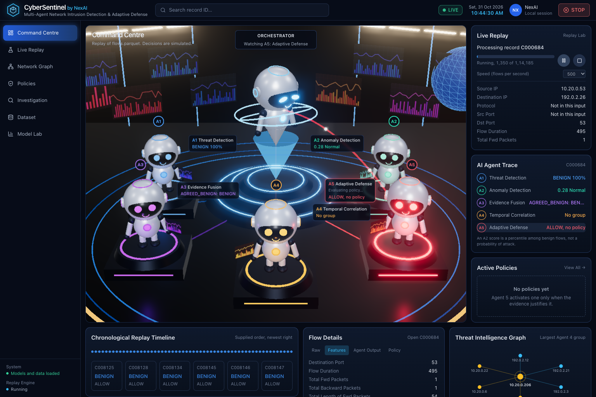

# CyberSentinel by NexAI

International Agentic AI Hackathon 2026, Track 1: Agentic AI for Cybersecurity.

Five agents classify network flows, score them for anomalies, fuse the evidence, correlate suspicious flows over time, and make explainable **simulated** ALLOW and BLOCK decisions. It replays recorded flows locally, and never touches a live network or firewall.



*The Command Centre during a rehearsal replay: real flows, with invented addresses.*

## The five agents

| Agent | Type | What it decides | Source |
|---|---|---|---|
| **A1 Threat Detection** | Trained: CatBoost, 5 classes | Class and confidence for each flow | [threat_agent.py](backend/agents/threat_agent.py) |
| **A2 Anomaly Detection** | Trained: Isolation Forest, on benign flows only | How unusual a flow is, as a percentile among benign flows (**not a probability of attack**) | [anomaly_agent.py](backend/agents/anomaly_agent.py) |
| **A3 Evidence Fusion** | Rules | Whether A1 and A2 agree, the final class, and why | [fusion_agent.py](backend/agents/fusion_agent.py) |
| **A4 Temporal Correlation** | Rules | Which suspicious flows belong together, from observed endpoints in a time window | [temporal_agent.py](backend/agents/temporal_agent.py) |
| **A5 Adaptive Defense** | Rules | When repeated evidence justifies a temporary `SOURCE_IP` block | [defense_agent.py](backend/agents/defense_agent.py) |

A3 to A5 are rules on purpose: every decision can be traced to the evidence behind it, and the website shows that reason for every record.

```
 flow features ──► A1 class + confidence ─┐
                                          ├─► A3 evidence ─► classification.csv
 flow features ──► A2 anomaly score ──────┘        │
                                                   ▼
 For each record, in the supplied order:
   1. Does an already active policy match its source?  Yes ─► BLOCK. It adds no new evidence.
   2. Otherwise ALLOW. A4 updates its groups, and A5 may activate a policy for LATER records only.
                                                   │
                                                   ▼
                                       replay.csv + policies.csv
```

A blocked flow keeps its prediction, and no decision reads a label or a later record. A separate check reruns the replay on parts of the stream to prove it.


   ##Results

### Labelled validation records (114,185)

No model or threshold was tuned on these. Regenerate with `scripts/evaluate.py`; full detail is in [evaluation_report.json](data/reports/evaluation_report.json).

| Metric | Value |
|---|---|
| Accuracy | 0.99995 |
| Macro-F1 | 0.99982 |
| False-positive rate (benign called attack) | 0.0050% |
| False-negative rate (attack called benign) | 0.0055% |

| Class | Precision | Recall | F1 | Support |
|---|---:|---:|---:|---:|
| BENIGN | 0.99995 | 0.99995 | 0.99995 | 60,001 |
| BRUTE_FORCE | 1.00000 | 0.99855 | 0.99928 | 1,384 |
| DOS | 0.99992 | 1.00000 | 0.99996 | 24,000 |
| DDOS | 1.00000 | 1.00000 | 1.00000 | 14,400 |
| PORT_SCAN | 0.99993 | 0.99993 | 0.99993 | 14,400 |

**A2:** ROC-AUC 0.884, recall 55.9% at a 5.0% false-positive rate. It flags 89% of DDoS and 73% of DoS flows, but only 0.07% of brute-force and 0.35% of port-scan flows.

**The classifier score reflects this capture, not networks in general.** Each attack class has almost constant TCP fingerprints. No single feature leaks the label: removing the 25 strongest still leaves macro-F1 at 0.9996 ([leakage_audit.py](scripts/leakage_audit.py)). A harder split, fitting on early record IDs and testing on late ones, gives 0.9973.

### Hidden set (200 unlabelled flows)

| Measure | Result |
|---|---|
| A1 classes | BENIGN 100, DOS 40, DDOS 24, PORT_SCAN 24, BRUTE_FORCE 12 |
| A3 evidence | 143 AGREE, 57 CONFLICT |
| A4 groups | 2 |
| A5 policies | 1: BLOCK `SOURCE_IP` 172.16.0.1, activated after F000032, through F000200 |
| Replay | 108 ALLOW, 92 BLOCK |

These describe what the system did, not whether it was right: the labels stay with the organisers.

**Why one policy:** all 100 attack calls come from one source, against one target, and the other 13 sources are all called benign. That policy stopped four attack phases over three days. Shorter policies would give 3 or 4, but block fewer attack calls (77 to 85 instead of 92), because each expiry lets the source through until A5 has the evidence again. The thresholds were not changed after seeing this set.

## Run it

You need Python 3.12, Node 20 or later, and the saved models in `models/`. Models are not in git: copy them from a teammate, or put the organisers' ZIP at `data/raw/cyber-pack.zip` and run `./scripts/run_all.sh` (about 7 minutes).

```bash
python3.12 -m venv .venv
```
```bash
.venv/bin/pip install -r requirements.txt
```
```bash
npm --prefix frontend ci
```
```bash
./scripts/run_local.sh
```

Open http://localhost:5173/data in Chrome and follow the [operator guide](docs/LOCAL_OPERATOR_GUIDE.md): choose your input folder, inspect the data, run the pipeline, and download the three files to submit.

Without the website:

```bash
.venv/bin/python scripts/run_level2.py --input PATH/TO/records.csv --out-dir data/processed/level2
```

Run the tests:

```bash
.venv/bin/python -m pytest -q
```

## What's in the website

- **Command Centre:** the five agents in 3D, with the orchestrator turning to the one working, a live trace, and a ledger of every policy.
- **Agent Decisions:** every record, what each agent decided, and why.
- **Dataset:** choose local folders, inspect files, run the pipeline, validate and export.
- **Network Graph, Policies, Investigation, Model Lab:** deeper views of campaigns, policies, single flows and model metrics.

## Known limitations

- **A4 and A5 have no measured accuracy on real endpoints.** The labelled pack has no endpoints, and the hidden set has no labels. Their thresholds and the 300-second window are engineering defaults, compared only on invented addresses ([tune_level2.py](scripts/tune_level2.py)).
- **A2 barely sees brute force or port scans,** so those decisions rest largely on A1.
- **A policy is a blunt tool:** it blocks everything from a source, including any benign flows it sends.
- **Without endpoints,** as in the labelled pack, A4 and A5 are off and only `classification.csv` is produced. Addresses are never invented for a real run.
- **Live replay investigations** are capped at 5 per batch. The batch evaluation investigates all of them.

## Disclosure

- **AI assistance:** this codebase was generated with Claude Code (Anthropic) from the team's engineering brief. Team members review, test and explain their modules: see [team ownership](docs/TEAM_OWNERSHIP.md).
- **Data:** organiser-provided CICIDS2017 pack and hidden set only. Neither is in this repository. Tests use synthetic fixtures, labelled as such.
- **Synthetic data:** `scripts/rehearse_level2.py` and `scripts/make_local_fixture.py` attach invented addresses to real flows for testing only, and say so. No prediction is mocked or hard-coded.
- **Third-party components:** scikit-learn, CatBoost, pandas, NumPy, PyArrow, FastAPI, Uvicorn, Pydantic, React, Vite, Tailwind CSS, three.js, Recharts, React Flow, Lucide, Playwright (tests only).
- **Credentials:** none are stored.

## Documentation

- [Operator guide](docs/LOCAL_OPERATOR_GUIDE.md): run it, step by step
- [Technical flow](docs/DAY2_TECHNICAL_FLOW.md): how a file becomes the three CSVs, by agent
- [Replay logic](docs/DAY2_REPLAY_LOGIC.md): the rules at each record
- [CSV schema](docs/DAY2_CSV_SCHEMA.md): the three submission files
- [Module contracts](docs/MODULE_CONTRACTS.md) and [API reference](docs/API.md)
- [Test report](docs/FINAL_TEST_REPORT.md)
- [Team ownership](docs/TEAM_OWNERSHIP.md)
