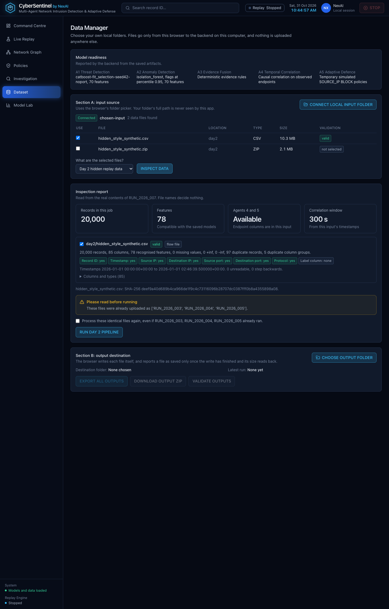
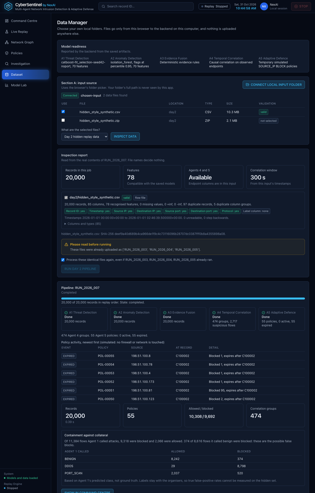
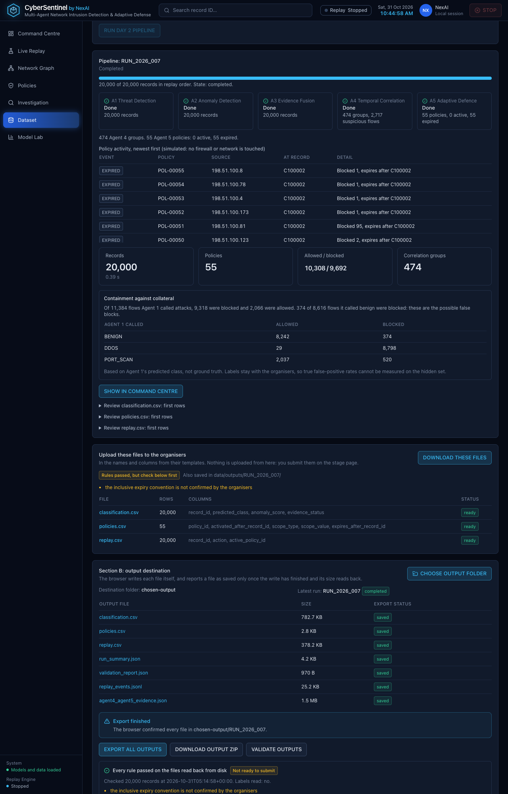

# Local operator guide

This guide takes you from a fresh clone to exported Day 2 files, on your own laptop. No cloud account is needed, and nothing leaves your computer.

Use **Chrome**. It can read and write the folders you pick. Other browsers can still do everything through your computer's normal folder picker and file downloads.

## Set up (once)

### 1. Clone the repository

```bash
git clone https://github.com/Arush-Developer/Nexai-JAI.git
```
```bash
cd Nexai-JAI
```

### 2. Install the dependencies

You need Python 3.12 and Node 20 or later.

On Mac or Linux:

```bash
python3.12 -m venv .venv
```
```bash
.venv/bin/pip install -r requirements.txt
```
```bash
npm --prefix frontend ci
```

On Windows, in PowerShell:

```powershell
py -3.12 -m venv .venv
```
```powershell
.venv\Scripts\pip install -r requirements.txt
```
```powershell
npm --prefix frontend ci
```

### 3. Get the saved models

The models are not in git, so a fresh clone does not have them. Do one of these:

- **Quickest:** copy the `models/` folder (about 3 MB) from a teammate into your repository folder.
- **Rebuild them:** put the organisers' ZIP at `data/raw/cyber-pack.zip`, then run `./scripts/run_all.sh`. This takes about 7 minutes.

You should end up with `models/threat_model/threat_agent.joblib` and `models/anomaly_model/anomaly_agent.joblib`.

## Run the Day 2 pipeline

### 4. Start the backend and frontend

On Mac or Linux, one command starts both. Press Ctrl+C to stop them.

```bash
./scripts/run_local.sh
```

On Windows, open two PowerShell windows. In the first:

```powershell
.venv\Scripts\python -m uvicorn backend.main:app --host 127.0.0.1 --port 8000
```

In the second:

```powershell
npm --prefix frontend run dev -- --host 127.0.0.1 --port 5173 --strictPort
```

### 5. Open the website

Go to **http://localhost:5173/data** in Chrome. In the side menu, this screen is called **Dataset**. The other screens show the official validation set, and need the dataset extracted. The Data Manager does not.

### 6 to 8. Choose your input



6. Click **CONNECT LOCAL INPUT FOLDER** and pick the folder holding the organisers' files. If Chrome asks for permission, allow it.
7. Tick only the CSV, ZIP or Parquet files you want. Each row shows its name, location, type and size.
8. Under "What are the selected files?", choose **Day 2 hidden replay data**.

### 9 to 11. Inspect, and read the report

9. Click **INSPECT DATA**. The files are sent to the backend on your own computer, then checked.
10. Read the report. It shows the records, features, record IDs, timestamps, endpoints, missing columns and invalid values, all taken from the file's real contents. Red items must be fixed. Amber items are for you to read and decide on.
11. Check **Model readiness** at the top, and that the report says the features are compatible with the saved models. **RUN DAY 2 PIPELINE** stays disabled until the input passes.

If a ZIP holds several data files, untick the ones that don't belong to this job. Files are never joined when their columns differ or their order is unknown.

### 12 to 15. Run it and watch



12. Click **RUN DAY 2 PIPELINE**.
13. Watch the five agent cards. They report what each agent is really doing.
14. Watch the progress bar. It counts records processed in replay order.
15. Watch the **Policy activity** table for policies activating and expiring. These are simulated: no firewall or network is touched.

### See it in the Command Centre

After a run, click **SHOW IN COMMAND CENTRE**, then press play in **Live Replay**. Small files replay at 2 flows a second, so you can follow them. **A4 and A5 show as off until you do this,** because the screens start on the official validation set, which has no IP addresses. Restarting the backend returns them to that set.

### 16 and 17. Review and validate

16. Open "Review classification.csv", "Review policies.csv" and "Review replay.csv" to see their first rows.
17. Click **VALIDATE OUTPUTS**. This reads the files back from disk and checks every rule.

**"Every rule passed" and "Ready to submit" are different.** The second stays off while the blockers listed under it remain. Today that is the expiry convention, which the organisers have not confirmed.

### 18 and 19. Export



18. Click **CHOOSE OUTPUT FOLDER** and pick any folder you can write to.
19. Click **EXPORT ALL OUTPUTS**. A new folder named after the run is created inside it. A file only shows "saved" after the browser finishes writing it and its size checks out.

If that run's folder already exists, nothing changes until you explicitly approve replacing its files. In any browser, you can also use **DOWNLOAD OUTPUT ZIP** or the individual file links.

| File | Contents |
|---|---|
| `classification.csv` | One prediction per record, including records later blocked |
| `policies.csv` | One row per activated policy |
| `replay.csv` | ALLOW or BLOCK for each record, with the active policy |
| `run_summary.json` | What was run, on which files, and the totals |
| `validation_report.json` | Rules checked, problems and blockers |
| `replay_events.jsonl` | Policy activations and expiries, in order |
| `agent4_agent5_evidence.json` | Correlation groups and policy evidence |

A copy of each run's files also stays in `data/outputs/`. Your uploaded originals stay in `data/staging/`. Git ignores both.

### 20. Submit

After a run, **Upload these files to the organisers** lists `classification.csv`, `policies.csv` and `replay.csv`, with a download button. You upload them yourself on the organisers' stage page. This app never sends them anywhere.

Before you do, confirm the expiry convention with the organisers, set `level2.defense.expiry_boundary` and `level2.expiry_boundary_confirmed` in `configs/default.yaml`, restart, and process the file again.

## When something goes wrong

| What you see | What it means | What to do |
|---|---|---|
| "Saved models are not ready" or "Model file not found" | **Missing model artifacts** | Do step 3 |
| "could not be loaded" under models | Your library versions differ from the ones that built the models | Reinstall from `requirements.txt`, or rebuild the models with `./scripts/run_all.sh` |
| "Backend unreachable" | The backend isn't running | Do step 4, and check its terminal for errors |
| "missing N model-required features" | **Wrong CSV columns.** The missing values are never invented | Check that it's the right file. If the organisers renamed columns, ask them, and add the spelling to the config |
| "non-numeric values in feature columns" | **Model preprocessing mismatch:** a feature holds text | Correct the file or ask the organisers. The report names the columns |
| "Agents 4 and 5 are off because source_ip column is absent" | **Missing source IP.** Addresses are never invented | Only `classification.csv` can be produced. Ask the organisers for the endpoint data |
| "No usable timestamps" | **Missing timestamps.** Agent 4 falls back to a count of records, which is not a time window | You can still run. Report the limitation, and ask the organisers if the brief requires timestamps |
| "missing mandatory column record_id" or "repeated record ids" | **Incorrect record IDs** | Use the organisers' original file. Every record needs one official ID |
| "This browser cannot write to a folder" | **Unsupported browser folder API** | Use Chrome on `localhost`, or use the downloads |
| "not a readable ZIP" or "refused, nothing was extracted" | **Invalid ZIP:** damaged, encrypted, unsafe paths, or expanding too far | Download it again. Do not extract and re-pack it without checking why |
| "declared Day 2 hidden replay data, but it has a label column" | The wrong file or the wrong dataset type | Choose the right one. The hidden set has no labels |
| "several flow files with no seq column" | The order across files is unknown | Select one file, or add the organisers' ordering file |
| "The replay order is ambiguous" | Timestamps or `seq` conflict with the file order | Ask the organisers. You can tick the box to proceed, and the run then won't be called ready |
| "Identical files were already processed" | This exact input already ran | Use the earlier run, or tick the box to process it again |
| "BLOCK by POL-… outside its active range" | **Policy mismatch or expiry error** in the files | Don't hand-edit outputs. Process the file again. If it persists, record the report and investigate before submitting |
| "header is [...], expected [...]" | **Output schema mismatch:** the file doesn't match the configured columns | Check `level2.columns` in the config, and process the file again |
